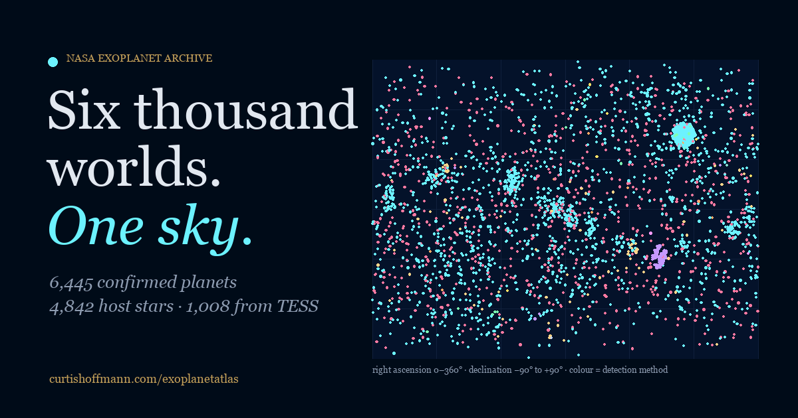

# Exoplanet Atlas

Six thousand worlds, one sky. An interactive atlas of every confirmed exoplanet in the NASA Exoplanet Archive.

Live at **https://curtishoffmann.com/exoplanetatlas/**



## What it does

- **Timeline.** A scrolling sky map of every planet, placed by right ascension and declination and colored by detection method, lighting up era by era from the 1992 pulsar planets to the present. The counts in each caption are computed from the data when the page is built.
- **System browser.** Search any of the host stars, see its star and planets drawn to scale with orbits animated at their true relative periods, and read the planet table. Every system has a permanent link, for example `#system/TRAPPIST-1`.
- **TESS spotlight.** What the Transiting Exoplanet Survey Satellite has found so far: all-sky footprint, per-year growth, and six systems worth knowing.
- **Database.** Mass–radius and insolation–radius diagrams with hover and tap tooltips, and a sortable, filterable table of every planet.

Plain HTML, CSS and JavaScript with D3 (pinned to 7.9.0 and loaded with an integrity hash). No framework, no tracking, no account. Works on a phone.

## Data

One query to the NASA Exoplanet Archive's TAP service, against the Planetary Systems table with `default_flag = 1`, so each planet appears once with the archive's preferred parameters. The exact query, the fetch date, the newest release date among the rows and the headline counts are stored in [`data/meta.json`](data/meta.json); the planets themselves are in [`data/planets.json`](data/planets.json), one compact record each (the key names are explained at the top of `fetch_data.py`).

The NASA Exoplanet Archive is operated by the California Institute of Technology, under contract with NASA under the Exoplanet Exploration Program. Please credit it when reusing the data.

## Refreshing and building

```bash
python3 fetch_data.py     # query the archive and rewrite data/planets.json and data/meta.json
python3 build.py          # regenerate index.html from src/template.html and the data
```

Both need only Python 3. `fetch_data.py --from-csv file.csv` converts a CSV you have already downloaded instead of querying. Open the site by serving the folder (`python3 -m http.server`); the page fetches `data/planets.json`, which browsers block from a bare `file://` URL.

To change the prose on the page, edit `src/template.html` or the era captions at the top of `build.py`, then run `build.py` again. Do not edit `index.html` by hand; it is overwritten.

## Repository layout

```
index.html         built page
src/template.html  page template
build.py           fills the template from the data (stats, era captions, notable systems, metadata)
fetch_data.py      pulls a fresh snapshot from the NASA Exoplanet Archive
data/planets.json  the planets
data/meta.json     query, dates and counts
assets/            stylesheet, script, social image, icons
robots.txt, sitemap.xml, LICENSE
```

## Earlier version

The first release (April 2026) carried the whole dataset inside `index.html` and its era captions were written by hand; several of the "+N planets" figures did not match the data. This version moves the data out, computes every figure, and refreshes the snapshot to October 2026.

## License

Code is released under the MIT License. The planet data belongs to the NASA Exoplanet Archive and is redistributed here unchanged apart from column selection and rounding.

Made by [Curtis Hoffmann](https://curtishoffmann.com/).
